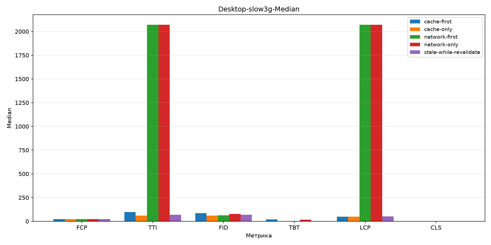
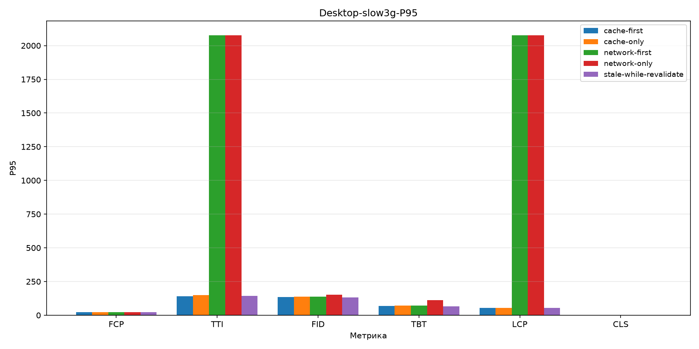
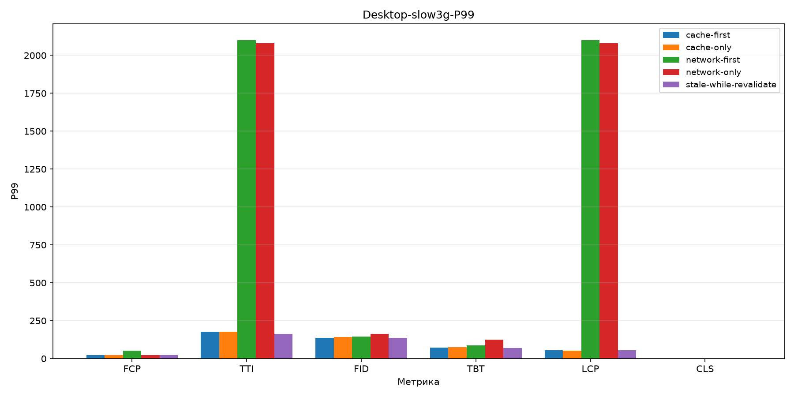
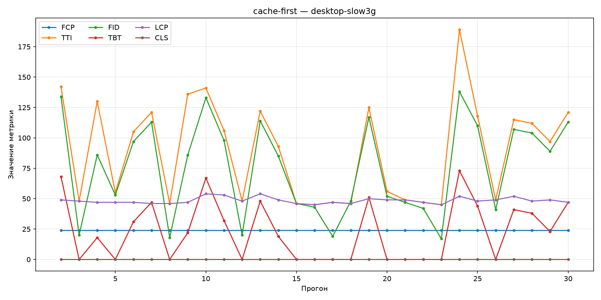
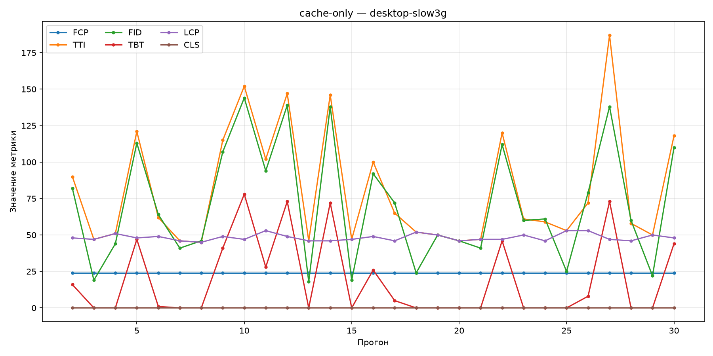
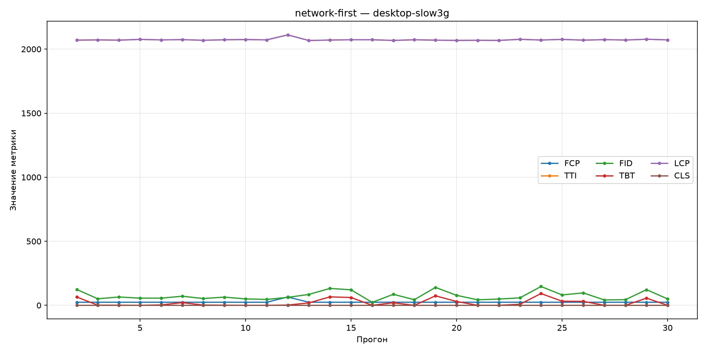
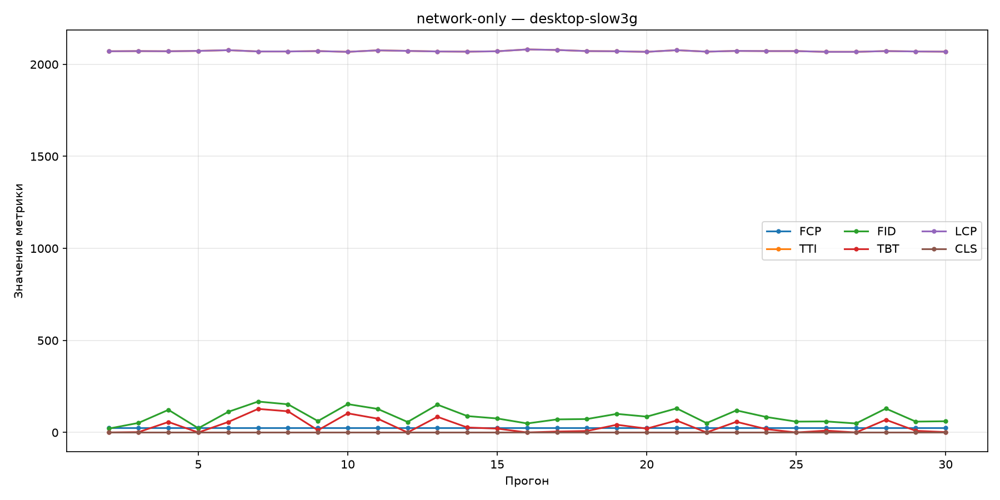
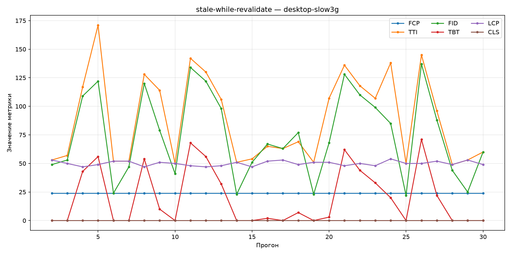

# Desktop slow 3G

| | |
|---|---|
| Условие | `desktop-slow3g` |
| Сгенерировано | `2026-10-17T10:59:39.752435+00:00` |
| Warmup прогонов исключено | 1 |
| n (наблюдений) | 29 |

## Сводные бар-графики

### Median

### P95

### P99

## Описательная статистика

| Стратегия | Метрика | Median | P95 | P99 | n |
|-----------|---------|--------|-----|-----|---|
| `cache-first` | FCP | 24 | 24 | 24 | 29 |
|  | TTI | 97 | 142 | 176 | 29 |
|  | FID | 86 | 134 | 137 | 29 |
|  | TBT | 19 | 67.6 | 71.6 | 29 |
|  | LCP | 48 | 53.6 | 54 | 29 |
|  | CLS | 0 | 0 | 0 | 29 |
| `cache-only` | FCP | 24 | 24 | 24 | 29 |
|  | TTI | 61 | 150 | 177 | 29 |
|  | FID | 61 | 139 | 143 | 29 |
|  | TBT | 0 | 73 | 76.6 | 29 |
|  | LCP | 48 | 53 | 53 | 29 |
|  | CLS | 0 | 0 | 0 | 29 |
| `network-first` | FCP | 24 | 24 | 53.5 | 29 |
|  | TTI | 2072 | 2077 | 2.1e+03 | 29 |
|  | FID | 62 | 137 | 145 | 29 |
|  | TBT | 2 | 70.8 | 87 | 29 |
|  | LCP | 2072 | 2.08e+03 | 2.1e+03 | 29 |
|  | CLS | 0 | 0 | 0 | 29 |
| `network-only` | FCP | 24 | 24 | 24 | 29 |
|  | TTI | 2071 | 2.08e+03 | 2.08e+03 | 29 |
|  | FID | 76 | 154 | 164 | 29 |
|  | TBT | 18 | 111 | 124 | 29 |
|  | LCP | 2071 | 2.08e+03 | 2.08e+03 | 29 |
|  | CLS | 0 | 0 | 0 | 29 |
| `stale-while-revalidate` | FCP | 24 | 24 | 24 | 29 |
|  | TTI | 69 | 144 | 164 | 29 |
|  | FID | 68 | 132 | 136 | 29 |
|  | TBT | 3 | 65.6 | 70.2 | 29 |
|  | LCP | 50 | 53 | 53.7 | 29 |
|  | CLS | 0 | 0 | 0 | 29 |

## Линейные графики по стратегиям

### `cache-first`

### `cache-only`

### `network-first`

### `network-only`

### `stale-while-revalidate`

## Значимые попарные сравнения

Пары с Mann–Whitney `p_value` < 0.05.

| Стратегия A | Стратегия B | Метрика | p-value | Effect size r | Bootstrap CI (median A − B) |
|-------------|-------------|---------|---------|---------------|-----------------------------|
| `cache-first` | `network-first` | TTI | 6.29e-11 | 1 | [-2024, -1953] |
| `cache-first` | `network-first` | LCP | 5.85e-11 | 1 | [-2026, -2022] |
| `cache-first` | `network-only` | TTI | 6.16e-11 | 1 | [-2023, -1953] |
| `cache-first` | `network-only` | LCP | 5.73e-11 | 1 | [-2025, -2022] |
| `cache-first` | `stale-while-revalidate` | LCP | 0.0052 | 0.424 | [-4, 0] |
| `cache-only` | `network-first` | TTI | 6.29e-11 | 1 | [-2021, -1971] |
| `cache-only` | `network-first` | LCP | 5.86e-11 | 1 | [-2026, -2022] |
| `cache-only` | `network-only` | TTI | 6.16e-11 | 1 | [-2020, -1971] |
| `cache-only` | `network-only` | LCP | 5.74e-11 | 1 | [-2025, -2022] |
| `cache-only` | `stale-while-revalidate` | LCP | 0.0037 | 0.441 | [-4, 0] |
| `network-first` | `stale-while-revalidate` | TTI | 6.31e-11 | -1 | [1957, 2018] |
| `network-first` | `stale-while-revalidate` | LCP | 6.01e-11 | -1 | [2020, 2024] |
| `network-only` | `stale-while-revalidate` | TTI | 6.17e-11 | -1 | [1957, 2017] |
| `network-only` | `stale-while-revalidate` | LCP | 5.89e-11 | -1 | [2020, 2023] |

Полные данные: [`comparisons/desktop-slow3g.json`](../assets/comparisons/desktop-slow3g.json).
