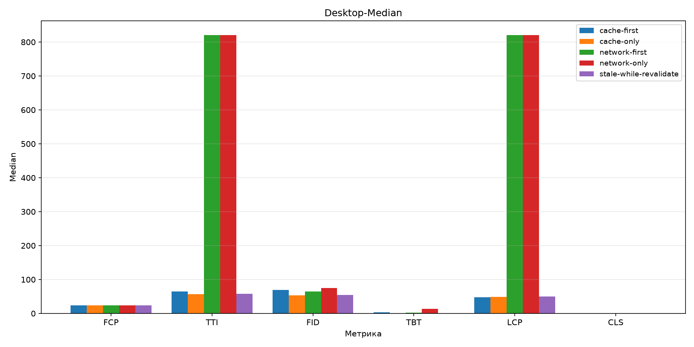
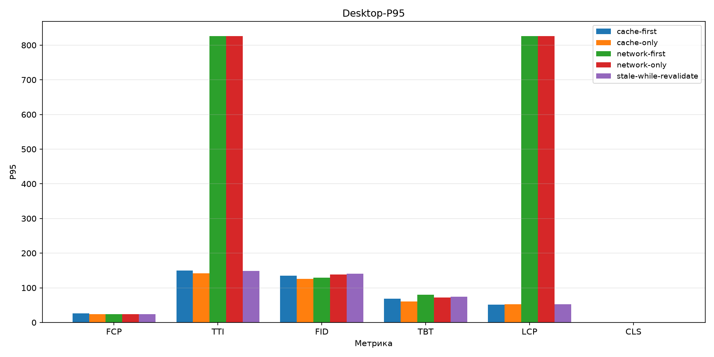
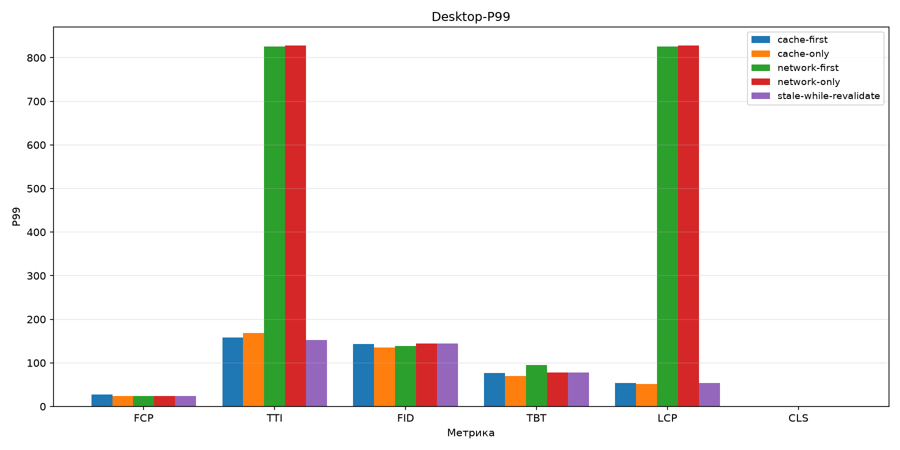
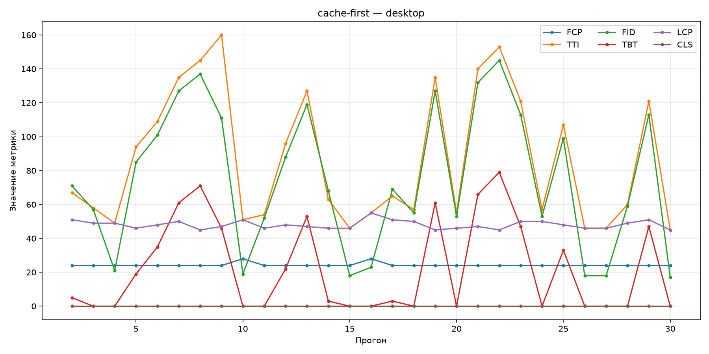
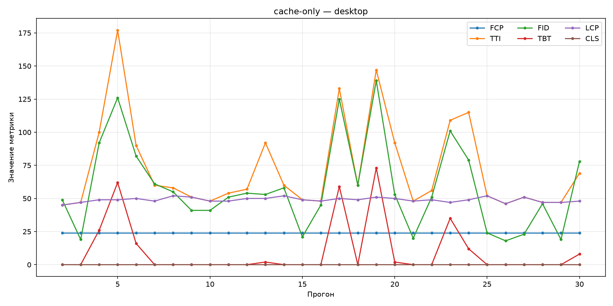
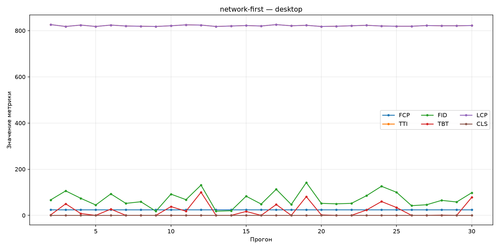
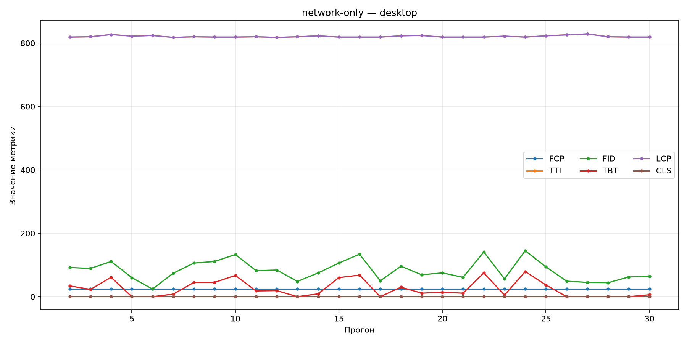
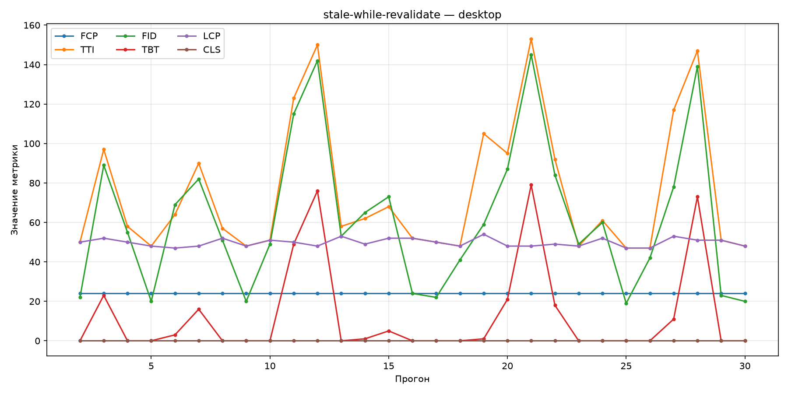

# Desktop

| | |
|---|---|
| Условие | `desktop` |
| Сгенерировано | `2026-10-25T11:30:35.784884+00:00` |
| Warmup прогонов исключено | 1 |
| n (наблюдений) | 29 |

## Сводные бар-графики

### Median

### P95

### P99

## Описательная статистика

| Стратегия | Метрика | Median | P95 | P99 | n |
|-----------|---------|--------|-----|-----|---|
| `cache-first` | FCP | 24 | 26.4 | 28 | 29 |
|  | TTI | 65 | 150 | 158 | 29 |
|  | FID | 69 | 135 | 143 | 29 |
|  | TBT | 3 | 69 | 76.8 | 29 |
|  | LCP | 48 | 51 | 53.9 | 29 |
|  | CLS | 0 | 0 | 0 | 29 |
| `cache-only` | FCP | 24 | 24 | 24 | 29 |
|  | TTI | 57 | 141 | 169 | 29 |
|  | FID | 53 | 126 | 135 | 29 |
|  | TBT | 0 | 60.8 | 69.9 | 29 |
|  | LCP | 49 | 52 | 52 | 29 |
|  | CLS | 0 | 0 | 0 | 29 |
| `network-first` | FCP | 24 | 24 | 24 | 29 |
|  | TTI | 821 | 826 | 826 | 29 |
|  | FID | 65 | 129 | 139 | 29 |
|  | TBT | 2 | 79.8 | 94.7 | 29 |
|  | LCP | 821 | 826 | 826 | 29 |
|  | CLS | 0 | 0 | 0 | 29 |
| `network-only` | FCP | 24 | 24 | 24 | 29 |
|  | TTI | 820 | 827 | 828 | 29 |
|  | FID | 75 | 138 | 144 | 29 |
|  | TBT | 14 | 72.2 | 77.9 | 29 |
|  | LCP | 820 | 827 | 828 | 29 |
|  | CLS | 0 | 0 | 0 | 29 |
| `stale-while-revalidate` | FCP | 24 | 24 | 24 | 29 |
|  | TTI | 58 | 149 | 152 | 29 |
|  | FID | 55 | 141 | 144 | 29 |
|  | TBT | 0 | 74.8 | 78.2 | 29 |
|  | LCP | 50 | 53 | 53.7 | 29 |
|  | CLS | 0 | 0 | 0 | 29 |

## Линейные графики по стратегиям

### `cache-first`

### `cache-only`

### `network-first`

### `network-only`

### `stale-while-revalidate`

## Значимые попарные сравнения

Пары с Mann–Whitney `p_value` < 0.05.

| Стратегия A | Стратегия B | Метрика | p-value | Effect size r | Bootstrap CI (median A − B) |
|-------------|-------------|---------|---------|---------------|-----------------------------|
| `cache-first` | `network-first` | TTI | 6.18e-11 | 1 | [-764, -712] |
| `cache-first` | `network-first` | LCP | 5.81e-11 | 1 | [-775, -771] |
| `cache-first` | `network-only` | TTI | 5.24e-11 | 1 | [-763, -711] |
| `cache-first` | `network-only` | LCP | 4.92e-11 | 1 | [-774, -770] |
| `cache-first` | `stale-while-revalidate` | LCP | 0.0041 | 0.436 | [-4, 1] |
| `cache-only` | `network-first` | TTI | 6.15e-11 | 1 | [-770, -752] |
| `cache-only` | `network-first` | LCP | 5.77e-11 | 1 | [-773, -770] |
| `cache-only` | `network-only` | TTI | 5.22e-11 | 1 | [-769, -750] |
| `cache-only` | `network-only` | FID | 0.0037 | 0.445 | [-43, -8] |
| `cache-only` | `network-only` | TBT | 0.0040 | 0.419 | [-34, -6] |
| `cache-only` | `network-only` | LCP | 4.89e-11 | 1 | [-773, -769] |
| `network-first` | `stale-while-revalidate` | TTI | 6.11e-11 | -1 | [731, 770] |
| `network-first` | `stale-while-revalidate` | LCP | 5.57e-11 | -1 | [769, 773] |
| `network-only` | `stale-while-revalidate` | TTI | 5.18e-11 | -1 | [729, 769] |
| `network-only` | `stale-while-revalidate` | FID | 0.0184 | -0.361 | [-3, 43] |
| `network-only` | `stale-while-revalidate` | TBT | 0.0249 | -0.332 | [2.98, 34] |
| `network-only` | `stale-while-revalidate` | LCP | 4.72e-11 | -1 | [768, 772] |

Полные данные: [`comparisons/desktop.json`](../assets/comparisons/desktop.json).
