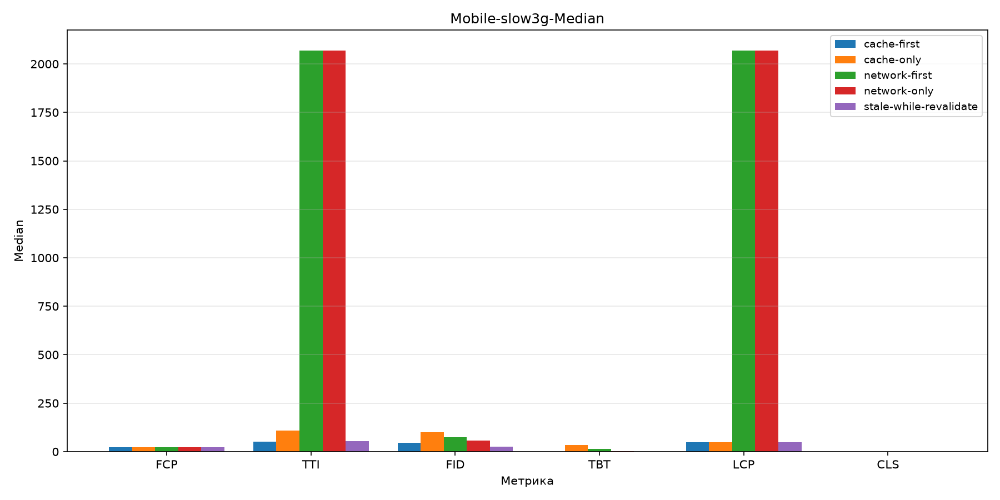
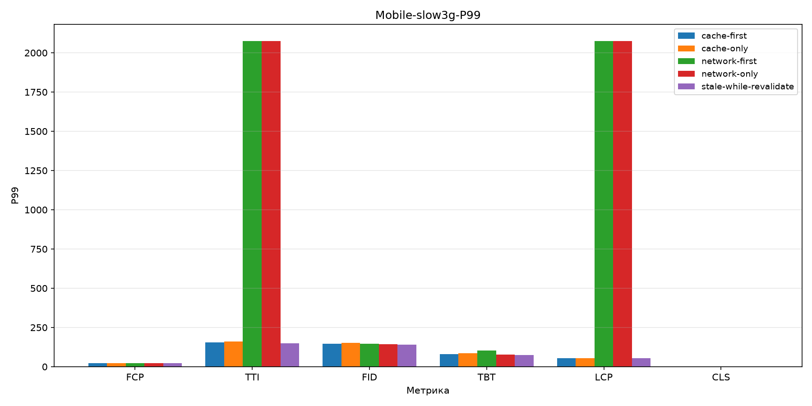
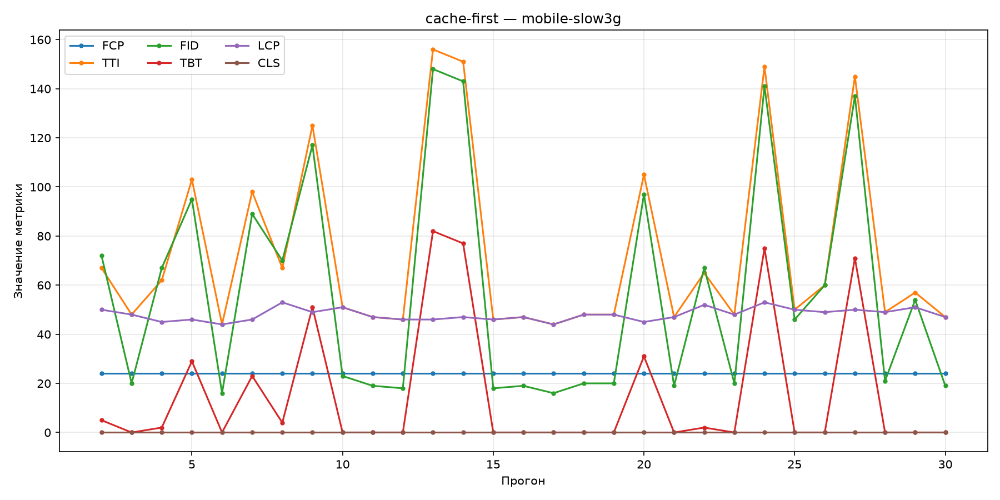
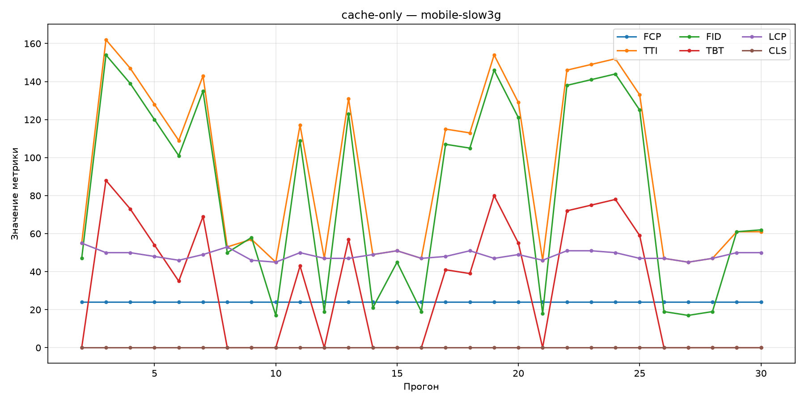
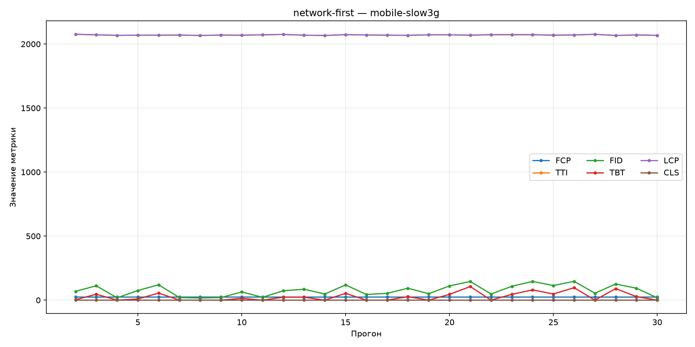
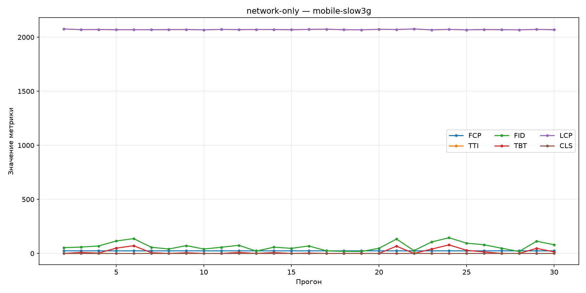
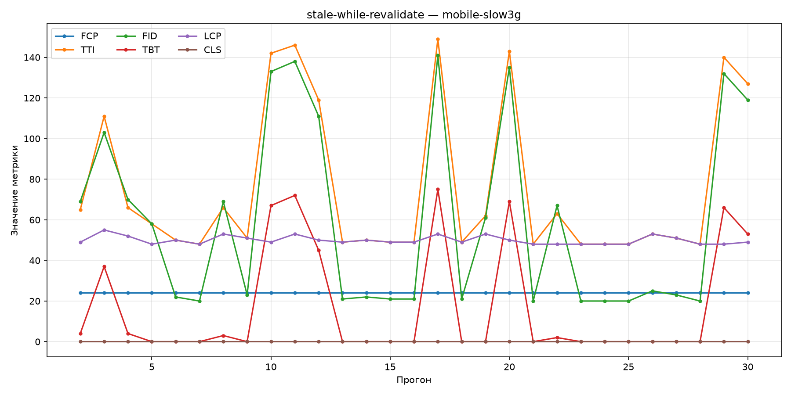

# Mobile slow 3G

| | |
|---|---|
| Условие | `mobile-slow3g` |
| Сгенерировано | `2026-10-25T11:30:40.275946+00:00` |
| Warmup прогонов исключено | 1 |
| n (наблюдений) | 29 |

## Сводные бар-графики

### Median

### P95

### P99

## Описательная статистика

| Стратегия | Метрика | Median | P95 | P99 | n |
|-----------|---------|--------|-----|-----|---|
| `cache-first` | FCP | 24 | 24 | 24 | 29 |
|  | TTI | 51 | 150 | 155 | 29 |
|  | FID | 46 | 142 | 147 | 29 |
|  | TBT | 0 | 76.2 | 80.6 | 29 |
|  | LCP | 48 | 52.6 | 53 | 29 |
|  | CLS | 0 | 0 | 0 | 29 |
| `cache-only` | FCP | 24 | 24 | 24 | 29 |
|  | TTI | 109 | 153 | 160 | 29 |
|  | FID | 101 | 145 | 152 | 29 |
|  | TBT | 35 | 79.2 | 85.8 | 29 |
|  | LCP | 49 | 52.2 | 54.4 | 29 |
|  | CLS | 0 | 0 | 0 | 29 |
| `network-first` | FCP | 24 | 24 | 24 | 29 |
|  | TTI | 2070 | 2.08e+03 | 2076 | 29 |
|  | FID | 73 | 146 | 147 | 29 |
|  | TBT | 14 | 94.2 | 103 | 29 |
|  | LCP | 2070 | 2.08e+03 | 2076 | 29 |
|  | CLS | 0 | 0 | 0 | 29 |
| `network-only` | FCP | 24 | 24 | 24 | 29 |
|  | TTI | 2070 | 2.08e+03 | 2076 | 29 |
|  | FID | 58 | 135 | 143 | 29 |
|  | TBT | 3 | 69.4 | 76.8 | 29 |
|  | LCP | 2070 | 2.08e+03 | 2076 | 29 |
|  | CLS | 0 | 0 | 0 | 29 |
| `stale-while-revalidate` | FCP | 24 | 24 | 24 | 29 |
|  | TTI | 53 | 145 | 148 | 29 |
|  | FID | 25 | 137 | 140 | 29 |
|  | TBT | 0 | 70.8 | 74.2 | 29 |
|  | LCP | 49 | 53 | 54.4 | 29 |
|  | CLS | 0 | 0 | 0 | 29 |

## Линейные графики по стратегиям

### `cache-first`

### `cache-only`

### `network-first`

### `network-only`

### `stale-while-revalidate`

## Значимые попарные сравнения

Пары с Mann–Whitney `p_value` < 0.05.

| Стратегия A | Стратегия B | Метрика | p-value | Effect size r | Bootstrap CI (median A − B) |
|-------------|-------------|---------|---------|---------------|-----------------------------|
| `cache-first` | `network-first` | TTI | 6.03e-11 | 1 | [-2023, -2003] |
| `cache-first` | `network-first` | LCP | 5.88e-11 | 1 | [-2025, -2021] |
| `cache-first` | `network-only` | TTI | 5.89e-11 | 1 | [-2023, -2003] |
| `cache-first` | `network-only` | LCP | 5.73e-11 | 1 | [-2024, -2021] |
| `cache-first` | `stale-while-revalidate` | LCP | 0.0022 | 0.465 | [-3, 0] |
| `cache-only` | `network-first` | TTI | 6.08e-11 | 1 | [-2017, -1941] |
| `cache-only` | `network-first` | LCP | 5.68e-11 | 1 | [-2.02e+03, -2019] |
| `cache-only` | `network-only` | TTI | 5.93e-11 | 1 | [-2017, -1941] |
| `cache-only` | `network-only` | LCP | 5.55e-11 | 1 | [-2024, -2020] |
| `cache-only` | `stale-while-revalidate` | LCP | 0.0451 | 0.304 | [-3, 1] |
| `network-first` | `stale-while-revalidate` | TTI | 5.93e-11 | -1 | [2004, 2022] |
| `network-first` | `stale-while-revalidate` | LCP | 5.32e-11 | -1 | [2019, 2023] |
| `network-only` | `stale-while-revalidate` | TTI | 5.79e-11 | -1 | [2004, 2021] |
| `network-only` | `stale-while-revalidate` | LCP | 5.19e-11 | -1 | [2019, 2022] |

Полные данные: [`comparisons/mobile-slow3g.json`](../assets/comparisons/mobile-slow3g.json).
