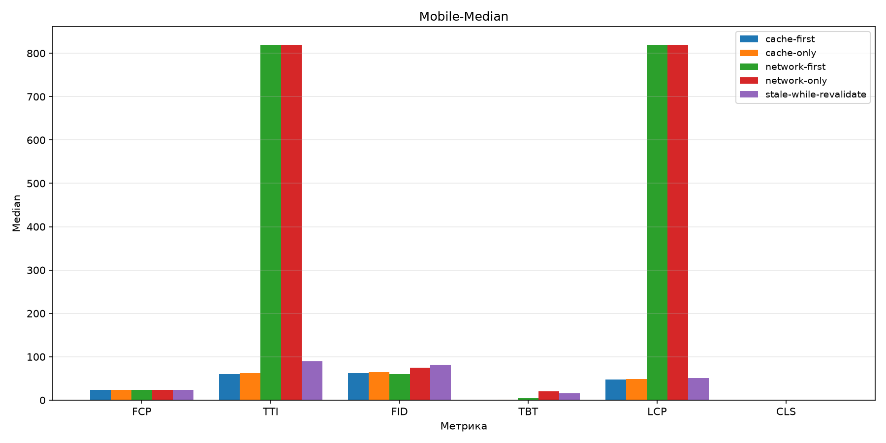
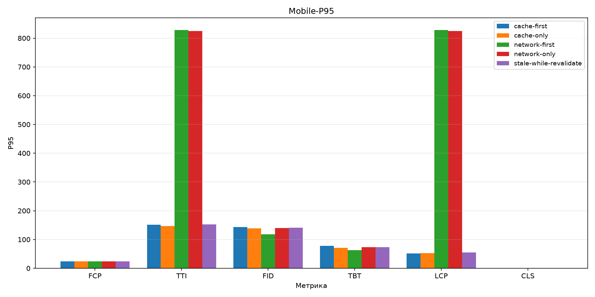
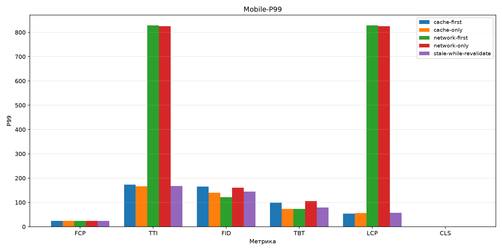
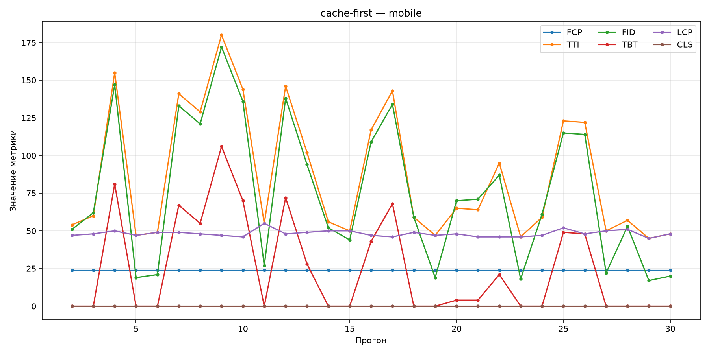
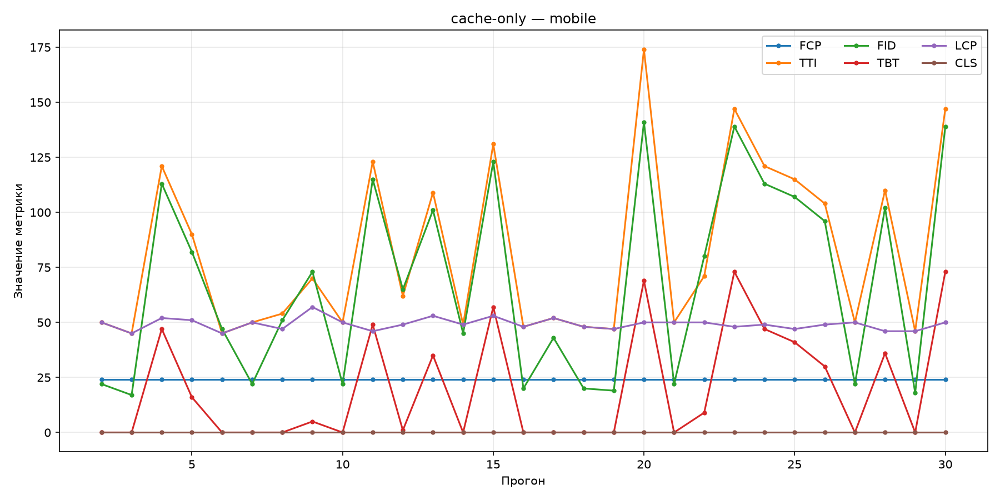
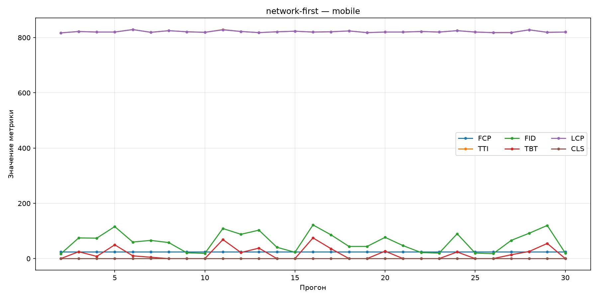
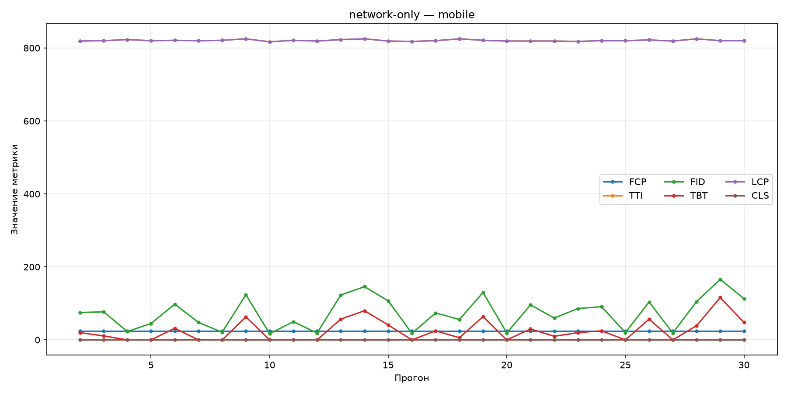
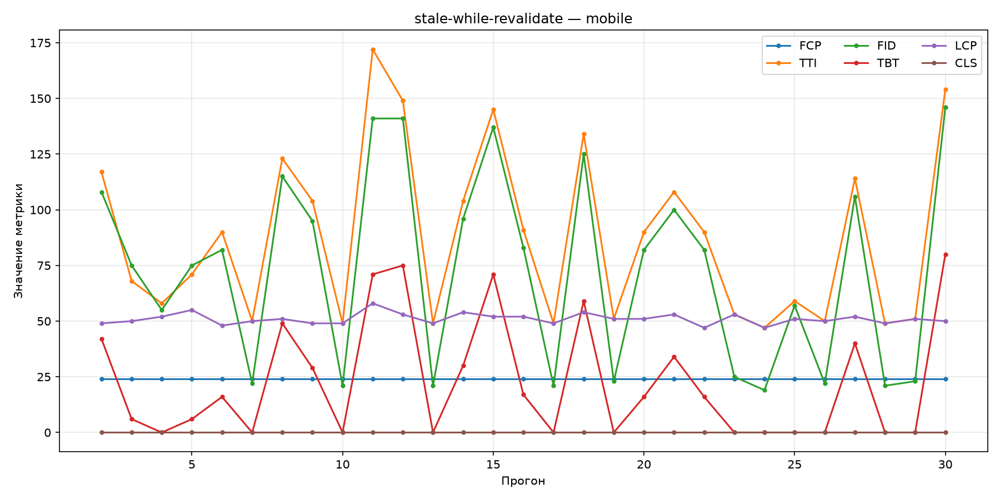

# Mobile

| | |
|---|---|
| Условие | `mobile` |
| Сгенерировано | `2026-10-25T12:41:14.331184+00:00` |
| Warmup прогонов исключено | 1 |
| n (наблюдений) | 29 |

## Сводные бар-графики

### Median

### P95

### P99

## Описательная статистика

| Стратегия | Метрика | Median | P95 | P99 | n |
|-----------|---------|--------|-----|-----|---|
| `cache-first` | FCP | 24 | 24 | 24 | 29 |
|  | TTI | 60 | 151 | 173 | 29 |
|  | FID | 62 | 143 | 165 | 29 |
|  | TBT | 0 | 77.4 | 99 | 29 |
|  | LCP | 48 | 51.6 | 54.2 | 29 |
|  | CLS | 0 | 0 | 0 | 29 |
| `cache-only` | FCP | 24 | 24 | 24 | 29 |
|  | TTI | 62 | 147 | 166 | 29 |
|  | FID | 65 | 139 | 140 | 29 |
|  | TBT | 1 | 71.4 | 73 | 29 |
|  | LCP | 49 | 53 | 55.9 | 29 |
|  | CLS | 0 | 0 | 0 | 29 |
| `network-first` | FCP | 24 | 24 | 24 | 29 |
|  | TTI | 820 | 829 | 829 | 29 |
|  | FID | 60 | 118 | 121 | 29 |
|  | TBT | 5 | 63.4 | 73.3 | 29 |
|  | LCP | 820 | 828 | 829 | 29 |
|  | CLS | 0 | 0 | 0 | 29 |
| `network-only` | FCP | 24 | 24 | 24 | 29 |
|  | TTI | 820 | 825 | 825 | 29 |
|  | FID | 75 | 140 | 160 | 29 |
|  | TBT | 20 | 73.6 | 106 | 29 |
|  | LCP | 820 | 825 | 825 | 29 |
|  | CLS | 0 | 0 | 0 | 29 |
| `stale-while-revalidate` | FCP | 24 | 24 | 24 | 29 |
|  | TTI | 90 | 152 | 167 | 29 |
|  | FID | 82 | 141 | 145 | 29 |
|  | TBT | 16 | 73.4 | 78.6 | 29 |
|  | LCP | 51 | 54.6 | 57.2 | 29 |
|  | CLS | 0 | 0 | 0 | 29 |

## Линейные графики по стратегиям

### `cache-first`

### `cache-only`

### `network-first`

### `network-only`

### `stale-while-revalidate`

## Значимые попарные сравнения

Пары с Mann–Whitney `p_value` < 0.05.

| Стратегия A | Стратегия B | Метрика | p-value | Effect size r | Bootstrap CI (median A − B) |
|-------------|-------------|---------|---------|---------------|-----------------------------|
| `cache-first` | `network-first` | TTI | 6.04e-11 | 1 | [-765, -703] |
| `cache-first` | `network-first` | LCP | 5.62e-11 | 1 | [-774, -771] |
| `cache-first` | `network-only` | TTI | 5.82e-11 | 1 | [-765, -703] |
| `cache-first` | `network-only` | LCP | 5.42e-11 | 1 | [-774, -771] |
| `cache-first` | `stale-while-revalidate` | LCP | 2.69e-05 | 0.639 | [-4, -1] |
| `cache-only` | `network-first` | TTI | 5.96e-11 | 1 | [-771, -711] |
| `cache-only` | `network-first` | LCP | 5.62e-11 | 1 | [-773, -770] |
| `cache-only` | `network-only` | TTI | 5.74e-11 | 1 | [-770, -711] |
| `cache-only` | `network-only` | LCP | 5.42e-11 | 1 | [-772, -769] |
| `cache-only` | `stale-while-revalidate` | LCP | 0.0088 | 0.398 | [-3, 0] |
| `network-first` | `stale-while-revalidate` | TTI | 5.98e-11 | -1 | [716, 767] |
| `network-first` | `stale-while-revalidate` | LCP | 5.73e-11 | -1 | [768, 771] |
| `network-only` | `stale-while-revalidate` | TTI | 5.77e-11 | -1 | [716, 767] |
| `network-only` | `stale-while-revalidate` | LCP | 5.52e-11 | -1 | [768, 771] |

Полные данные: [`comparisons/mobile.json`](../assets/comparisons/mobile.json).
